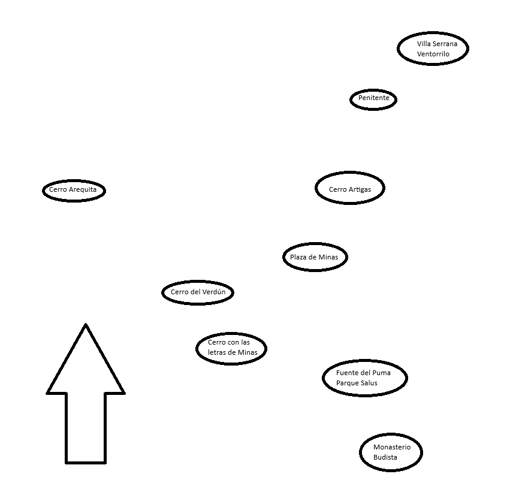

# Orden y distribución del recorrido

El escenario y la navegación conservan las nueve posiciones del esquema aportado por el usuario. El encargo del 8 de noviembre añade Parque Rodó entre Plaza Libertad y Arequita:

1. Monasterio budista.
2. Fuente del Puma / Reserva Natural Salus.
3. Letras de Minas.
4. Cerro del Verdún.
5. Plaza de Minas / Plaza Libertad.
6. Parque Rodó de Minas.
7. Cerro Arequita y Santa Lucía.
8. Cerro Artigas.
9. Salto del Penitente.
10. Villa Serrana: Ventorrillo → represa Stewart Vargas.

Arequita precede a Artigas por confirmación expresa del usuario, aunque ambos están prácticamente a la misma altura en el dibujo.

`src/data/journeyRoute.ts` conserva los centros aproximados del esquema. La transformación es uniforme: derecha de la imagen → +X; abajo de la imagen → +Z; cinco unidades de escena por píxel. La separación deja lugar para la nueva base ancha del Verdún y conserva las proporciones y posiciones relativas, con Arequita a la izquierda y Villa Serrana en el extremo superior derecho. Es una distribución esquemática, no un mapa georreferenciado.

`journeyStops.ts` ordena las fichas y `src/three/journeySites.ts` vincula cada ID con su modelo y encuadre. Ambos consumen el mismo recorrido: botones, numeración, anterior/siguiente, reproducción automática y reinicio quedan alineados. El terreno y el bosque abarcan la nueva distribución; las áreas de apoyo de los modelos quedan separadas. Las luces locales de la plaza se trasladan junto con su modelo.

`npm run check:journey-models` comprueba la secuencia confirmada, avance hacia arriba, posiciones laterales, separación entre áreas de apoyo, límites del terreno y correspondencia entre las fichas y la escena.

La distribución horizontal se conserva mientras el Verdún constituye la cumbre más alta y la ladera más ancha del escenario. La comprobación usa alturas mundiales y mide la ladera elevada, excluyendo el parche plano que rodea el cerro. La vista general se aleja para incluir su nueva extensión.

Parque Rodó ocupa el centro esquemático `(416, 362)` de la imagen, transformado a `(-45, -280)` en la escena; no desplaza ningún centro previo. Sus tres visitas de cámara muestran entrada, lago/mirador y ruedo, mientras Villa Serrana conserva dos. Son diez paradas públicas y trece visitas de 22 segundos (286 s). `check:parque-rodo` compara las nueve posiciones previas contra el HEAD de origen y prueba la continuidad entre las trece visitas en ambos modos.
